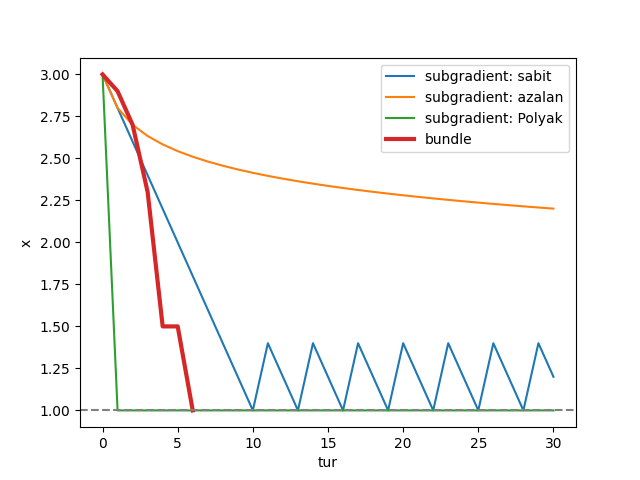

# Mini bundle method

A from-scratch proximal bundle method in Python, applied to the Lagrangian dual
of a small knapsack problem and compared with the subgradient method.
No optimization libraries: the master problem is solved by my own exact solver.



## Problem: knapsack Lagrangian dual

Three items (values 6, 10, 4; weights 2, 5, 4), capacity 6. The best feasible
value is 10. Dualizing the capacity constraint with a price λ gives

```
L(λ) = Σ max(0, value_i − λ·weight_i) + λ·capacity
```

Every λ gives an upper bound on the true optimum (weak duality). Minimizing
L(λ) gives the tightest one. L is convex and piecewise linear, so it has kinks
where the derivative does not exist; a subgradient is
`capacity − (total weight of items with positive net value)`.

## How the bundle method works

1. **Cuts.** At each visited point, store (point, value, subgradient). Each cut
   is a line that never goes above L.
2. **Model.** The max of all cuts: a cheap lower approximation of L.
3. **Next point.** Minimize `model(x) + (x − center)² / (2t)`. The second term
   keeps the step close to the current center; `t` controls how far it may go.
   I solve this master problem exactly: the optimum is either a single-cut
   step `center − t·slope` or an intersection of two cuts, so I list those
   candidates and pick the best.
4. **Serious / null step.** If the new point is really better, move the center
   there and double `t`; otherwise keep the center, halve `t`, but keep the cut.
5. **Stop** when the model predicts no meaningful improvement.

## Results (start λ = 3)

| method | behaviour |
|---|---|
| subgradient, constant step | oscillates between 1.4 and 2.2 forever |
| subgradient, diminishing step | still oscillating around 2 after 30 steps |
| subgradient, Polyak step | reaches 2 in two steps, but needs the optimal value (14) in advance |
| **bundle** | **reaches λ = 2 in 3 iterations and stops by itself** |

The bundle method finds λ = 2 with L(2) = 14, an upper bound 4 above the
integer optimum (the duality gap, caused by items being indivisible).

## Why the bundle method wins

The subgradient method only uses the current slope and forgets everything else.
Near a kink the slope does not shrink, so a fixed step keeps jumping over the
minimum. The bundle method keeps every cut, builds a model of the function from
them, and steps to where the model is lowest, while the proximal term and the
serious/null test protect it when the model is wrong. That is also how large
solvers such as SMS++ optimize Lagrangian duals.

## Files

- `bundle.py`: the algorithm only; `f` and `subgradient` are passed in
- `knapsack.py`: the knapsack dual
- `karsilastirma.py`: comparison with Polyak, constant and diminishing steps
- `test_bundle.py`: tests, including a brute-force grid solver as a referee

## Run

```
pip install matplotlib pytest
python knapsack.py
python karsilastirma.py
python -m pytest
```
